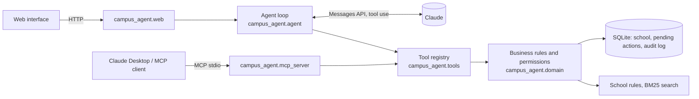
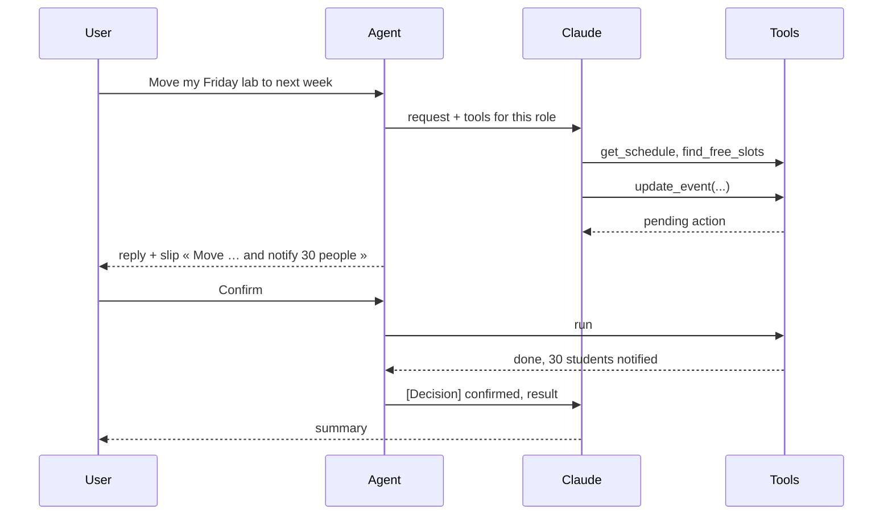

# Ker Avel campus agent

[](https://github.com/charbel-dib/ensta_chatbot/actions/workflows/tests.yml)

**Live demo: [agent-campus.onrender.com](https://agent-campus.onrender.com)**, no sign-up; each
visitor gets a private copy of the school. Built by [Charbel Dib](https://www.linkedin.com/in/charbel-dib7)
([portfolio](https://charbel-dib.vercel.app)).

An AI agent for an engineering school: it reads calendars, finds common free slots, books rooms
and appointments, moves classes and tells the students, handles absence justifications, issues
certificates and answers from the school rules, with citations. It acts with the rights of the
person signed in, and **nothing changes until that person confirms**.

It runs on a fictional school, *École d'ingénieurs Ker Avel*: 290 students, 30 teachers, 3 staff,
26 rooms and a full semester, all generated. The same tools are served to a web interface, through
the Claude API, and to any MCP client such as Claude Desktop.

This repository started as a RAG chatbot over the ENSTA website ([version 0](docs/ensta-rag.md),
still in `app.py`). The agent is the next step: from answering questions to doing the work. Its
document search uses BM25 by default, with the E5 embeddings of version 0 as an option
(`CAMPUS_DOCS_RETRIEVER=dense`).

## In one minute

| Claude Haiku 5.5 (default) | Pass rate | Cost per scenario | Time per scenario |
|---|---:|---:|---:|
| 29 tuning scenarios, 3 runs each | **87/87** | 0.06 cent | 4.6 s |
| 12 held-out scenarios, 3 runs each | **35/36** | 0.08 cent | 5.0 s |

Sonnet 5.5 passes the same scenarios at about **24 times the cost**, so Haiku is the default
([details](#evaluation)).

- **18 tools, filtered by role.** A student books a study room or an appointment, a teacher
  moves a class for their groups, the school office reviews justifications.
- **Every write waits for the user.** The agent proposes, the user sees a slip with the exact
  action and confirms; the server then checks every rule again before writing.
- **Permissions live on the server**, not in the prompt: a student who talks the model into
  asking for someone else's grades still gets a refusal from the tool.
- **Measured**: 41 scenarios checked on the database after each run (12 of them held out), plus
  87 tests that need no model call.

## Try it

```bash
pip install -r requirements-agent.txt
echo ANTHROPIC_API_KEY=sk-ant-... > .env      # set a monthly spend limit in the Anthropic console first

python -m campus_agent.cli ask --as stu-0001 "Prends-moi un rendez-vous avec M. Le Goff" -v
uvicorn campus_agent.web:app --port 8002      # then open http://127.0.0.1:8002
```

The school is generated on first start (`campus_data/campus.db`, about 0.2 s). `python -m
campus_agent.cli reset` regenerates it. Set `CAMPUS_NOW=2026-11-16T09:00` to pin the clock, as
the evaluation does.

With Docker: `docker build -t campus-agent . && docker run -p 8000:8000 -e ANTHROPIC_API_KEY=...
-e CAMPUS_SECRET_KEY=... campus-agent`.

### Personas of the demo

| Id | Person | Try |
|---|---|---|
| `stu-0001` | Inès Haddad, 3rd year, AI track | « J'étais absente au TP de vendredi, j'ai un certificat médical » |
| `stu-0003` | Maël Guivarc'h, 1st year | « Combien de temps ai-je pour justifier une absence ? » |
| `tch-001` | Yann Le Goff, machine learning | « Je ne peux pas assurer mon TP de vendredi : déplace-le la semaine prochaine et préviens les étudiants » |
| `tch-008` | Hugo Lefèvre, calculus | « Organise un rattrapage de deux heures pour le groupe 1A-TD1 la semaine prochaine » |
| `stf-01` | Claire Morvan, school office | « Quelles justifications d'absence sont en attente ? » |

## What the agent can do

| Tool | Student | Teacher | Office | Writes |
|---|:-:|:-:|:-:|:-:|
| `search_people`, `search_courses` | ✓ | ✓ | ✓ | |
| `get_schedule` (own in detail; others as busy/free only) | ✓ | ✓ | ✓ | |
| `find_free_slots` (people, groups, a free room) | ✓ | ✓ | ✓ | |
| `find_available_rooms` | study rooms | teaching rooms | all | |
| `get_grades` | own, published | own courses | all | |
| `get_absences` | own | own courses | all | |
| `search_documents` (school rules, cited) | ✓ | ✓ | ✓ | |
| `get_messages`, `list_tickets` | ✓ | ✓ | ✓ | |
| `generate_certificate` (PDF) | own | | ✓ | |
| `create_event` | study room, appointment in office hours | classes for own groups, meetings | ✓ | ✓ |
| `update_event`, `cancel_event` (participants notified) | own events | own courses | ✓ | ✓ |
| `justify_absence` (within five working days) | ✓ | | | ✓ |
| `review_absence` | | | ✓ | ✓ |
| `send_announcement` | | own groups | ✓ | ✓ |
| `create_ticket` | ✓ | ✓ | ✓ | ✓ |

The school rules the tools enforce are the ones written in its documents
([`campus_agent/data/docs`](campus_agent/data/docs)): study rooms two hours at most and once a
day, appointments of 15 to 30 minutes inside a teacher's office hours, no class on Wednesday
afternoon, justification within five working days, a refusal always explained, and so on.

## How it works



One registry describes each tool once (schema, roles, read or write). The agent, the MCP server
and the evaluation all go through it, so the rules cannot drift between interfaces.

**Confirmation of writes.** A write tool never runs from the model's call. The registry validates
it in a dry run, stores a *pending action* with a summary written by the server (not by the
model), and returns « waiting for confirmation » to the model. Only the user's click runs it, and
the business function checks everything again at that moment: if the slot was taken meanwhile,
the action fails cleanly and the agent is told why.



In an MCP client, the client's own approval step plays that role: writes run when called, and
every write tool carries `destructiveHint` so the client asks the user first.

## Built for production, not only for the demo

- **Permissions from the token, never from the conversation.** The web API signs a token for the
  person (a demo login here; the school's single sign-on in production). Every business function
  checks what this person may see or change.
- **Data minimisation (GDPR).** Other people's calendars come back as busy/free only. A student sees
  other students' names and groups, not their e-mail. Free text in the audit log is truncated.
- **Prompt injection.** Text written by users (event notes, messages) comes back to the model
  labelled as user data, and the instructions say it is never an order. Even when the model is
  fooled, the attacker's text cannot widen the user's rights, and every write still needs the
  user's click. Two evaluation scenarios plant such text, a third has the user claim another role.
- **Audit trail.** Every tool call is logged with who, what, through which channel and with which
  outcome (`ok`, `pending`, `executed`, `denied`, `conflict`…); the office sees it in the interface.
- **Cost control.** Prompt caching of the tools, instructions and conversation; a step cap per
  turn; a budget per conversation, per visitor and per day; the cost of each exchange computed from the
  published prices and shown to the user.
- **Robustness.** Retries with back-off on rate limits and overloads, timeouts, tool errors
  returned to the model so it can recover, history trimmed only on turn boundaries.
- **Engineering.** Typed settings from the environment, a dependency-light core (standard library,
  `requests`, `reportlab`), 87 tests for the agent, CI that also builds the Docker image and probes it,
  non-root container with a health check.

## Evaluation

`eval/agent_scenarios.json` holds 29 scenarios in seven categories: reading, rules (with the
expected citation), planning (actions confirmed by the harness), permissions, ambiguous requests,
conflicts and injection; `eval/agent_heldout.json` holds 12 more, kept aside. Each runs on a fresh copy of the school; the checks look at the tools
called, the actions proposed, **the database afterwards** and the reply. No model grades another.

```bash
python eval/run_agent_eval.py --model claude-haiku-5-5
python eval/run_agent_eval.py --model claude-sonnet-5-5
python eval/run_agent_eval.py --set heldout --repeat 3
```

### Results (November 2026)

All runs on the same code; reports and full transcripts in [`eval/results/`](eval/results).

| Model | Scenarios | Runs | Passed | Total cost | Per scenario | Time | Model calls |
|---|---|---:|---:|---:|---:|---:|---:|
| Haiku 5.5, first run | tuning set | 29 | 24 | $0.024 | 0.08 ¢ | 4.6 s | 2.7 |
| **Haiku 5.5** | tuning set | 87 | **87** | $0.055 | 0.06 ¢ | 4.6 s | 2.9 |
| **Haiku 5.5** | held-out set | 36 | **35** | $0.030 | 0.08 ¢ | 5.0 s | 3.1 |
| Sonnet 5.5 | tuning set | 29 | 29 | $0.434 | 1.50 ¢ | 5.6 s | 2.8 |
| Sonnet 5.5 | held-out set | 12 | 11 | $0.181 | 1.51 ¢ | 6.7 s | 3.2 |

**Which model.** On these tasks Haiku 5.5 does as well as Sonnet 5.5 for a twenty-fourth of the price
and is a little faster, so it is the default (`CAMPUS_MODEL`). The tools carry most of the
difficulty (permissions, conflicts, free slots), which suits a small model. Sonnet would be worth
its price for longer, open-ended planning.

**The held-out set.** Tuning on the same scenarios one measures inflates the score, so after the
fixes I wrote 12 new scenarios (other people, wordings and traps) and ran them once, as they are,
without changing the agent afterwards.

### Where it breaks

What the runs showed, and what was done about it:

- **Asking instead of acting (first run).** Asked to move a class or to justify an absence, the
  agent listed the options and asked « which one? » or « shall I? ». With a confirmation slip, that
  question is redundant: the instructions now tell it to propose the action directly and let the
  slip carry the consent, and to ask only when information is missing.
- **Picking from a long list (1 run in 87, before the fix).** Asked for the oldest pending justification, Haiku
  took the second-to-last item of a list sorted newest first, and named the wrong weekday from a
  bare ISO date. Fixed in the tool, not the prompt: `get_absences` now sorts oldest first on
  request and gives every date in words.
- **The test, not the agent (held-out, Haiku, 1 run in 3).** « Cancel my lab next Wednesday »,
  said on a Monday, can mean the day after tomorrow or the week after. In one run Haiku asked which
  one, while the scenario expected the later date: the question was a right answer, and the miss
  is counted as it was pre-registered. Sonnet picked the later date, said so, and offered to switch.
- **Acting on a vague request (held-out, Sonnet).** « Annule mon cours » with three classes that
  week: Haiku asked which; Sonnet proposed cancelling the lecture for 100 students and named the
  alternatives. The slip showed exactly that, so a real user would refuse it, but this is the
  cost of the « propose directly » rule with a more decisive model. Next step: ask when several
  events match a destructive request (not yet measured, so not claimed).
- **Harness defects (first run).** A check for « € » always failed, because the accent folding
  erased the symbol; a request for missing information was only recognised by its question
  mark. Both fixed and covered by tests; the first-run report is kept as it was.

Not covered by the evaluation: long conversations (beyond a few turns), simultaneous users, and
other languages than French.

## Public demo

The demo is a free Render web service described by [`render.yaml`](render.yaml), built from the
Dockerfile and redeployed on every push to `main`. It runs with `CAMPUS_SANDBOX=1`: each visitor receives a
private copy of the school when choosing a persona, kept across persona changes and dropped after six
hours without activity, so visitors never see each other's bookings and the demo never wears out. Each
visitor has 30 messages and at most $0.15; a ledger shared by all copies caps the whole demo at $2 a day.
A scheduled workflow ([`keep-alive.yml`](.github/workflows/keep-alive.yml)) calls it every ten minutes so
that it does not spin down.

## Use it from Claude Desktop

Add the server to Claude Desktop's configuration (`claude_desktop_config.json`), choosing who it acts for:

```json
{
  "mcpServers": {
    "ker-avel": {
      "command": "python",
      "args": ["-m", "campus_agent.mcp_server", "--as", "tch-001"],
      "env": { "PYTHONPATH": "C:/path/to/ensta_chatbot" }
    }
  }
}
```

## Repository

| Path | What |
|---|---|
| `campus_agent/domain/` | Business rules and permissions: calendar, academics, messaging, documents, audit |
| `campus_agent/tools.py` | Tool registry, validation, pending actions and confirmation |
| `campus_agent/agent.py`, `llm.py` | Agent loop, Claude client, cost accounting |
| `campus_agent/web.py`, `static/` | HTTP API and interface |
| `campus_agent/mcp_server.py` | MCP server |
| `campus_agent/seed.py`, `data/docs/` | Generated school and its written rules |
| `eval/run_agent_eval.py` | Scenario evaluation |
| `tests/` | Tests (agent, tools, rules, web, MCP, evaluation harness, and the v0 RAG) |
| `app.py`, `ENSTA_DATASET/` | Version 0, the ENSTA RAG ([its README](docs/ensta-rag.md)) |

## Limits and next steps

- SQLite and an in-memory rate limiter fit one process; several workers need PostgreSQL and a
  shared store.
- The calendar is the school's own. An adapter to Google Calendar or Microsoft 365 would sit behind
  the same business functions.
- The demo login stands in for single sign-on; the MCP server acts for one person set at start, where
  a remote deployment would read the person from an OAuth token.
- Internship agreements and grade entry are documented in the rules but not yet tools.

MIT licence. The school, its people and its data are fictional.
