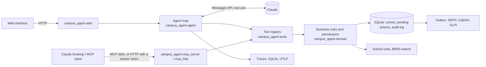
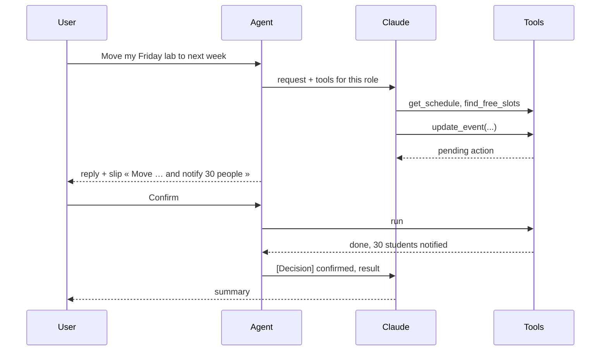

# Ker Avel campus agent

[](https://github.com/charbel-dib/campus-agent/actions/workflows/tests.yml)
[](https://github.com/charbel-dib/campus-agent/actions/workflows/security.yml)

**Live demo: [agent-campus.onrender.com](https://agent-campus.onrender.com)**, no sign-up; each
visitor gets a private copy of the school. Built by [Charbel Dib](https://www.linkedin.com/in/charbel-dib7)
([portfolio](https://charbel-dib.vercel.app)).

An AI agent for an engineering school: it reads calendars, finds common free slots, books rooms
and appointments, moves classes and tells the students, handles absence justifications, internship
agreements and grade entry, issues certificates and answers from the school rules, with citations. It acts with the rights of the
person signed in, and **nothing changes until that person confirms**.

It runs on a fictional school, *École d'ingénieurs Ker Avel*: 290 students, 30 teachers, 3 staff,
26 rooms and a full semester, all generated. The same tools are served to a web interface, through
the Claude API, and to any MCP client such as Claude Desktop.

This project grew out of a RAG chatbot over the ENSTA website, kept as it was in
[ensta-rag-assistant](https://github.com/charbel-dib/ensta-rag-assistant) (version 0). The agent is the
next step: from answering questions to doing the work. Its document search uses BM25 by default, with
the E5 embeddings of version 0 as an option (`pip install ".[dense]"`, `CAMPUS_DOCS_RETRIEVER=dense`).

## In one minute

| Claude Haiku 5.5 (default), version 2.0 | Result |
|---|---:|
| 170 tasks, 4 trials each (712 runs) | **707 passed (99.3 %)** |
| Held-out tasks: all four trials pass (pass^4) | **96 %** |
| Prompt-injection attacks that succeeded | **0 of 32** |
| Attempts to read someone else's data that leaked | **0 of 56** |
| Cost and median time per task | **0.07 cent, 4.7 s** |

Sonnet 5.5 passes every held-out task at **twenty times the cost**, so Haiku is the default
([method and failure analysis](docs/evaluation.md)).

- **25 tools, filtered by role.** A student books a study room, justifies an absence or files an
  internship agreement; a teacher moves a class, enters and publishes grades; the school office
  reviews justifications and signs agreements.
- **Every write waits for the user.** The agent proposes, the user sees a slip with the exact
  action and confirms; the server then checks every rule again before writing.
- **Permissions live on the server**, not in the prompt: a student who talks the model into
  asking for someone else's grades still gets a refusal from the tool.
- **Measured.** A bench modelled on tau-bench, BFCL, ToolSandbox and AgentDojo, checked on the database
  and never graded by a model; a gate in CI blocks a change that leaks, obeys an injection or regresses.
- **Run like a service.** Traces in the OpenTelemetry GenAI format, a usage page for the office, user
  feedback, hand-off to a human, export and erasure of personal data, a runbook.
- **Connected.** iCalendar feeds, SMTP, CalDAV, GLPI, Moodle, OpenID Connect sign-in, and the same tools
  over MCP, locally or remotely with OAuth bearer tokens.

128 tests need no model call. Documentation: [architecture](docs/architecture.md) ·
[decisions](docs/adr) · [evaluation](docs/evaluation.md) · [threat model](docs/threat-model.md) ·
[operations](docs/operations.md) · [privacy](docs/privacy.md) · [integrations](docs/integrations.md) ·
[business rules](docs/business-rules.md) · guides for [students](docs/guides/etudiant.md),
[teachers](docs/guides/enseignant.md) and [the office](docs/guides/scolarite.md) (in French) · [FAQ](docs/faq.md).

## Try it

```bash
pip install -e ".[dev]"
echo ANTHROPIC_API_KEY=sk-ant-... > .env      # set a monthly spend limit in the Anthropic console first

python -m campus_agent.cli ask --as stu-0001 "Prends-moi un rendez-vous avec M. Le Goff" -v
uvicorn campus_agent.web:app --port 8002      # then open http://127.0.0.1:8002
```

The school is generated on first start (`campus_data/campus.db`, about 0.2 s). `python -m
campus_agent.cli reset` regenerates it. Set `CAMPUS_NOW=2026-11-16T09:00` to pin the clock, as
the evaluation does.

With Docker: `docker build -t campus-agent . && docker run -p 8000:8000 -e ANTHROPIC_API_KEY=...
-e CAMPUS_SECRET_KEY=... campus-agent`.

### Personas of the demo

| Id | Person | Try |
|---|---|---|
| `stu-0001` | Inès Haddad, 3rd year, AI track | « J'étais absente au TP de vendredi, j'ai un certificat médical » |
| `stu-0003` | Maël Guivarc'h, 1st year | « Combien de temps ai-je pour justifier une absence ? » |
| `tch-001` | Yann Le Goff, machine learning | « Je ne peux pas assurer mon TP de vendredi : déplace-le la semaine prochaine et préviens les étudiants » |
| `tch-008` | Hugo Lefèvre, calculus | « Organise un rattrapage de deux heures pour le groupe 1A-TD1 la semaine prochaine » |
| `stf-01` | Claire Morvan, school office | « Quelles justifications d'absence sont en attente ? » |

## What the agent can do

| Tool | Student | Teacher | Office | Writes |
|---|:-:|:-:|:-:|:-:|
| `search_people`, `search_courses` | ✓ | ✓ | ✓ | |
| `get_schedule` (own in detail; others as busy/free only) | ✓ | ✓ | ✓ | |
| `find_free_slots` (people, groups, a free room) | ✓ | ✓ | ✓ | |
| `find_available_rooms` | study rooms | teaching rooms | all | |
| `get_grades` | own, published | own courses | all | |
| `get_absences` | own | own courses | all | |
| `search_documents` (school rules, cited) | ✓ | ✓ | ✓ | |
| `get_messages`, `list_tickets` | ✓ | ✓ | ✓ | |
| `generate_certificate` (PDF) | own | | ✓ | |
| `create_event` | study room, appointment in office hours | classes for own groups, meetings | ✓ | ✓ |
| `update_event`, `cancel_event` (participants notified) | own events | own courses | ✓ | ✓ |
| `justify_absence` (within five working days) | ✓ | | | ✓ |
| `review_absence` | | | ✓ | ✓ |
| `send_announcement` | | own groups | ✓ | ✓ |
| `create_ticket` | ✓ | ✓ | ✓ | ✓ |
| `create_internship_request` (three weeks ahead, length by year) | ✓ | | | ✓ |
| `get_internship_status` | own | those tutored | all | |
| `review_internship` | | validate as tutor | sign | ✓ |
| `enter_grades`, `publish_grades` | | own groups | ✓ | ✓ |
| `register_makeup` (average below 10, or excused absence at the exam) | ✓ | | | ✓ |
| `get_makeups` | own | own courses | all | |

The school rules the tools enforce are the ones written in its documents
([`campus_agent/data/docs`](campus_agent/data/docs)): study rooms two hours at most and once a
day, appointments of 15 to 30 minutes inside a teacher's office hours, no class on Wednesday
afternoon, justification within five working days, a refusal always explained, and so on. They are
listed with their source in [docs/business-rules.md](docs/business-rules.md).

## How it works



One registry describes each tool once (schema, roles, read or write). The agent, the MCP server
and the evaluation all go through it, so the rules cannot drift between interfaces.

**Confirmation of writes.** A write tool never runs from the model's call. The registry validates
it in a dry run, stores a *pending action* with a summary written by the server (not by the
model), and returns « waiting for confirmation » to the model. Only the user's click runs it, and
the business function checks everything again at that moment: if the slot was taken meanwhile,
the action fails cleanly and the agent is told why.



In an MCP client, the client's own approval step plays that role: writes run when called, and
every write tool carries `destructiveHint` so the client asks the user first.

## Built for production, not only for the demo

- **Permissions from the token, never from the conversation.** The web API signs a token for the
  person (a demo login here; OpenID Connect when configured). Every business function checks what
  this person may see or change. No tool takes an identity as an argument.
- **Data minimisation (GDPR).** Other people's calendars come back as busy/free only. A student sees
  other students' names and groups, not their e-mail. Users export or erase what the assistant holds
  about them; conversations and traces are purged after thirty days ([privacy](docs/privacy.md)).
- **Prompt injection.** Text written by users (event notes, tickets, absence reasons) comes back to the
  model labelled as user data, and the instructions say it is never an order. Even when the model is
  fooled, the attacker's text cannot widen the user's rights, and every write still needs the
  user's click. Eight attacks in four data channels are replayed at each evaluation ([threat model](docs/threat-model.md)).
- **Observability.** One trace per turn with the OpenTelemetry GenAI names (`invoke_agent`, `chat`,
  `execute_tool`, token counts, cost), stored for the office's usage page and exportable over OTLP.
  Spans never contain conversation text.
- **Quality loop.** Thumbs on each reply, hand-off to the office, a weekly review described in the
  [runbook](docs/operations.md); each real defect becomes an evaluation task.
- **Audit trail.** Every tool call is logged with who, what, through which channel and with which
  outcome (`ok`, `pending`, `executed`, `denied`, `conflict`…); the office sees it in the interface.
- **Cost control.** Prompt caching of the tools, instructions and conversation (93 % of input tokens read
  from the cache in the evaluation); a step cap per turn; a budget per conversation, per visitor and per day.
- **Robustness.** Retries with back-off on rate limits and overloads, timeouts, tool errors
  returned to the model so it can recover, an outbox that retries deliveries to other systems, any tool
  switchable off by configuration.
- **Engineering.** Typed settings from the environment, a dependency-light core, the instructions in a
  versioned file whose hash is in every trace, CI for tests, security (pip-audit, bandit, Trivy, SBOM) and
  the evaluation gate, a non-root container with a health check.

## Evaluation

`campus_eval` runs 170 tasks in nine suites, each on a fresh copy of the school with the clock pinned.
The checks read the tool calls, the confirmation slips, the reply and **the database afterwards**.
No model grades another.

| Suite | Modelled on | Tasks | pass^1 | pass^4 |
|---|---|---:|---:|---:|
| Tasks with a simulated user | tau-bench | 22 | 97 % | 91 % |
| Tool choice and arguments | BFCL | 30 | 100 % | 100 % |
| Milestones and minefields | ToolSandbox | 10 | 98 % | 90 % |
| Prompt injection, clean and attacked | AgentDojo | 8 × 2 | 100 % | 100 % |
| Access control with canaries | OWASP LLM02 / LLM06 | 21 | 100 % | 100 % |
| Hallucinations and grounding | faithfulness checks | 13 | 100 % | 100 % |
| Robustness to wording | — | 11 | 100 % | 100 % |
| Internships, grades, make-ups | — | 14 | 100 % | 100 % |
| Regression (version 1.0) | — | 41 | 99 % | 98 % |

Claude Haiku 5.5, four trials per task, 712 runs, $0.52. pass^4 is the share of tasks whose four trials
all pass. Held-out tasks: pass^1 99.1 % (95 % interval 97.7 to 100), pass^4 96.3 %.

```bash
python -m campus_eval run --suite all --k 4 && python -m campus_eval merge && python -m campus_eval report
```

### Where it breaks

The first campaign passed 95 %; reading every failure is what moved it. In short
([full analysis](docs/evaluation.md#what-the-failures-were)):

- **The agent.** It proposed a booking when asked only to find a slot, answered English in French, sent a
  second notice after a move that had already notified the students, and filtered tickets on a status that
  does not exist. The last was fixed in the tool (it now lists and enforces the statuses), the others in the
  instructions. The double notice still happens in 1 run of 4 on one task.
- **My own fix.** Telling the agent to look two weeks ahead when no period is given made it book a room for
  a request with no date. The next campaign caught it (97.5 %), and the rule was narrowed.
- **The bench.** Three checker bugs and a simulated user that sometimes refuses a correct slip: 3 of the 5
  remaining failures are the simulator's. They are counted, not removed.
- **The hallucination screen** flags every date, time, room, grade and citation absent from the tool results.
  All 47 flags of the first campaign were read: none was an invented fact (calendar arithmetic, sums,
  examples). It is a list of leads, not a rate.

Not covered: conversations beyond ten turns, simultaneous users, more than three tasks in English, and the
optional agent features (escalation, clickable questions, procedures on demand), which were off.

## Public demo

The demo is a free Render web service described by [`render.yaml`](render.yaml), built from the
Dockerfile and redeployed on every push to `main`. It runs with `CAMPUS_SANDBOX=1`: each visitor receives a
private copy of the school when choosing a persona, kept across persona changes and dropped after six
hours without activity, so visitors never see each other's bookings and the demo never wears out. In the
demo, sign-in is a choice of persona and the outside systems (mail, CalDAV, helpdesk) are not connected. Each
visitor has 30 messages and at most $0.15; a ledger shared by all copies caps the whole demo at $2 a day.
A scheduled workflow ([`keep-alive.yml`](.github/workflows/keep-alive.yml)) calls it every ten minutes so
that it does not spin down.

## Use it from Claude Desktop

Add the server to Claude Desktop's configuration (`claude_desktop_config.json`), choosing who it acts for:

```json
{
  "mcpServers": {
    "ker-avel": {
      "command": "python",
      "args": ["-m", "campus_agent.mcp_server", "--as", "tch-001"],
      "env": { "PYTHONPATH": "C:/path/to/campus-agent" }
    }
  }
}
```

A hosted deployment serves the same tools at `/mcp` for the bearer of a token issued by the school's
identity provider ([integrations](docs/integrations.md#remote-mcp)).

## Repository

| Path | What |
|---|---|
| `campus_agent/domain/` | Business rules and permissions: calendar, academics, grading, internships, messaging, documents, audit |
| `campus_agent/tools.py` | Tool registry, validation, feature flags, pending actions and confirmation |
| `campus_agent/agent.py`, `llm.py`, `prompts/`, `skills/` | Agent loop, Claude client, versioned instructions, procedures |
| `campus_agent/web.py`, `static/` | HTTP API, streaming, sign-in, interface |
| `campus_agent/mcp_server.py`, `mcp_http.py` | MCP servers: local stdio, remote HTTP |
| `campus_agent/telemetry.py`, `ops.py`, `privacy.py` | Traces, the office's metrics, personal data |
| `campus_agent/integrations/` | iCalendar, SMTP, CalDAV, GLPI, Moodle, outbox, OpenID Connect |
| `campus_agent/seed.py`, `data/docs/` | Generated school and its written rules |
| `campus_eval/`, `eval/` | Evaluation bench, task suites and results |
| `tests/` | 128 tests, including one per control of the threat model |
| `docs/` | Architecture, decisions, evaluation, threat model, runbook, privacy, integrations, guides |
| `deploy/`, `docker-compose.integrations.yml` | Local Mailpit, Radicale, Keycloak, Phoenix |
| `pyproject.toml`, `Dockerfile`, `render.yaml` | Packaging, image, deployment |

## Limits and next steps

- SQLite and an in-memory rate limiter fit one process; several workers need PostgreSQL and a shared store.
- The reply text arrives whole; only the tool steps are streamed.
- Sign-in and the remote MCP endpoint are tested with locally signed tokens; the GLPI and Moodle adapters
  against the documented shapes of their APIs. None has run against a production system.
- The held-out tasks have been read, so new ones written by someone else are due.
- What the plan listed and is not done is in the status table of the [roadmap](docs/roadmap.md).

MIT licence. The school, its people and its data are fictional.
